# MA_vax: vaccination-impact analysis report

Massachusetts, 2025–2026 influenza season (2025-09-01 to 2026-07-04, 307 days). Age-structured SEIR model with a parallel vaccinated arm, calibrated to daily hospital admissions by age group with Bayesian MCMC. This report documents the model, the fit and the vaccination-impact analysis, including scenarios that raise vaccination coverage to 50–70% or cut the season's doses by 5–20%.

Every count is a **hospital admission over the whole 307-day season** unless stated otherwise. Intervals are 95% intervals across 726 simulations, one per posterior parameter draw.

## Summary

- The fitted baseline produces **8,268** [7,715 – 8,802] hospitalizations, against **22,545** with no vaccination: the 38.6% overall coverage achieved averts **14,346 [11,362 – 16,901]** hospitalizations (**63.4% [58.0% – 66.7%]**).
- Raising every age group to a coverage target (groups already above it unchanged) averts 2,860 [2,599 – 3,087] more at 50%, 3,589 [3,283 – 3,865] more at 55%, 4,219 [3,874 – 4,532] more at 60%, 4,787 [4,416 – 5,134] more at 65%, 5,279 [4,881 – 5,665] more at 70% (vs. baseline).
- Removing doses from every age group adds 476 [419 – 519] at −5%, 976 [856 – 1,069] at −10%, 1,501 [1,308 – 1,647] at −15%, 2,049 [1,773 – 2,260] at −20% hospitalizations.
- Per dose, vaccinating school-age groups prevents the most hospitalizations across the population (Table S.A.2: 13-17 1,926 and 5-12 1,821 per 100,000 doses), mostly through indirect protection of 65+.

---

## 1. Model structure

### 1.1 Compartments

Nine compartments, each stratified by 7 age groups (`0`, `1-4`, `5-12`, `13-17`, `18-49`, `50-64`, `65+`):

| Compartment | Meaning |
|---|---|
| `S` | Susceptible, unvaccinated |
| `E` | Exposed (latent), unvaccinated |
| `I` | Infectious, unvaccinated |
| `R` | Recovered (either arm) |
| `SV` | Susceptible, vaccinated |
| `EV` | Exposed (latent), vaccinated |
| `IV` | Infectious, vaccinated |
| `H` | Hospitalized (either arm) |
| `D` | Dead (either arm) |


*Model structure*

The vaccinated arm (`SV → EV → IV → H/R`) mirrors the unvaccinated arm (`S → E → I → H/R`) with its own susceptibility and severity parameters. `H`, `R` and `D` are shared, so vaccination history is not tracked once hospitalized or recovered.

### 1.2 Force of infection

Contacts come from fixed age × age contact matrices (Mistry et al. 2021), with school and work contacts removed on non-school / non-work days:

```
C(t) = total_C − (1 − is_school(t))·school_C − (1 − is_work(t))·work_C
beta_adj(t) = beta_baseline · m(t) · (1 + humidity_impact · exp(−180 · humidity(t)))
wtd_inf_prop(t) = (I·I_relative_infectiousness + IV·IV_relative_infectiousness) / population
foi(t) = beta_adj(t) · (C(t) @ wtd_inf_prop(t))
S_to_E   = foi(t) · relative_suscept   · S
SV_to_EV = foi(t) · vax_susceptibility · SV
```

`m(t)` is a smoothly time-varying transmission multiplier (§2.3) that absorbs behavioural and seasonal variation the mechanistic terms do not capture. `1 − vax_susceptibility` is the vaccine effectiveness (VE) against infection.

### 1.3 Progression, hospitalization, death

```
E_to_I  = E_to_I_rate · E                 EV_to_IV = EV_to_IV_rate · EV
I_to_H  = I_out_rate · I_to_H_prop · I     IV_to_H  = I_out_rate · IV_to_H_prop · IV
I_to_R  = I_out_rate · (1−I_to_H_prop)·I   IV_to_R  = I_out_rate · (1−IV_to_H_prop)·IV
H_to_D  = H_out_rate · H_to_D_prop · H
H_to_R  = H_out_rate · (1−H_to_D_prop)·H
```

### 1.4 Vaccination flow

Daily doses (an age-specific share of the population, applied 14 days after the dose date to represent the delay to immunity) move an exact count from `S` to `SV` each day, capped at what remains in `S`:

```
S_to_SV(t) = min(round(vax_prop(t − delay) · (S + SV)), S)
```

A dose scheduled for someone who has already been infected is not delivered by the model (the cap). Those doses are still bought and given in reality, so every "per 100,000 doses" figure divides by **scheduled** doses (appendix B).

### 1.5 Simulation and uncertainty

Explicit Euler integration with 7 sub-steps per day. Every interval comes from a **posterior parameter ensemble**: one deterministic run per posterior draw (726 draws), the same draws for every scenario, so differences between scenarios are paired. Intervals therefore reflect calibration uncertainty, not epidemic-process noise.

---

## 2. Parameters

### 2.1 Fixed scalar parameters

| Parameter | Value | Meaning |
|---|---:|---|
| `relative_suscept` | 1.0 | Susceptibility multiplier, unvaccinated arm |
| `I_relative_infectiousness` | 1.0 | Infectiousness weight, unvaccinated `I` |
| `IV_relative_infectiousness` | 1.0 | Infectiousness weight, vaccinated `IV` |
| `E_to_I_rate` | 0.5 | Latent → infectious rate (/day) |
| `EV_to_IV_rate` | 0.5 | Same, vaccinated arm (/day) |
| `I_out_rate` | 0.333 | Infectious-period exit rate (/day) |
| `H_out_rate` | 0.17 | Hospital exit rate (/day) |
| `vax_transfer_delay_days` | 14.0 | Days from dose to modelled immunity |

### 2.2 Age-stratified parameters

| Age group | Population | Hosp. risk given infection¹ | Hosp. risk given breakthrough¹ | Death risk given hosp. | Residual susceptibility if vaccinated | Initial infections seeded |
|---|---:|---:|---:|---:|---:|---:|
| 0 | 68,723 | 3.003% (2.211–3.464%) [0.697%] | 2.739% (2.016–3.159%) [0.636%] | 1.74% | 0.57 | 2 |
| 1-4 | 287,051 | 2.275% (1.332–3.308%) [0.697%] | 2.075% (1.215–3.017%) [0.636%] | 1.74% | 0.57 | 8 |
| 5-12 | 625,439 | 0.781% (0.459–1.220%) [0.274%] | 0.712% (0.418–1.113%) [0.250%] | 1.17% | 0.57 | 18 |
| 13-17 | 406,983 | 0.387% (0.210–0.596%) [0.274%] | 0.353% (0.191–0.543%) [0.250%] | 1.17% | 0.57 | 12 |
| 18-49 | 3,112,693 | 0.462% (0.277–0.716%) [0.561%] | 0.421% (0.252–0.652%) [0.511%] | 2.63% | 0.79 | 89 |
| 50-64 | 1,351,323 | 1.443% (0.866–2.202%) [1.060%] | 1.314% (0.789–2.006%) [0.966%] | 6.30% | 0.79 | 39 |
| 65+ | 1,420,722 | 11.966% (7.229–17.253%) [9.091%] | 8.257% (4.988–11.904%) [6.273%] | 7.99% | 1.00 | 41 |

¹ Fitted: pre-fit value × the age group's fitted multiplier (§2.4), posterior mean (95% interval), pre-fit value in brackets. Both columns share the multiplier, so VE against hospitalization given infection is unchanged by the fit. Seeds are pre-fit values, scaled by one fitted multiplier. A residual susceptibility of 1.00 (65+) means vaccination blocks no infection there: it only reduces severity, and vaccinating 65+ has no indirect effect on other age groups.

### 2.3 Fitting method

Affine-invariant ensemble MCMC (64 walkers, 4000 iterations each) over the 307-day target window.

| Parameter | Prior | Role |
|---|---|---|
| `beta_baseline` | Uniform(0.015, 0.06) | Baseline transmission rate |
| `humidity_impact` | Uniform(0, 1) | Strength of humidity forcing |
| Initial-seed multiplier | Log-uniform(0.1, 10.0) | Multiplies the age-specific seed counts |
| Hospitalization-risk multiplier (× 7) | Uniform(0.1, 5.0) | Multiplies both hospitalization-risk columns of one age group |
| `m(t)` log-increments (× 22) | Normal(0, 0.25) | Random-walk steps in log-transmission, knots every 14 days |
| `phi` | — | Negative-binomial dispersion (likelihood only) |

**Likelihood**: negative-binomial (NB2), jointly over 8 targets: daily admissions for each age group (weights 0_0: 1, 1_4: 1, 5_12: 1, 13_17: 1, 18_49: 2, 50_64: 2, 65plus: 5) and end-of-season cumulative admissions by age (weight 10).

**Posterior sample**: first 1700 iterations discarded, then every 200th kept, giving **726 draws**. "Best" is the draw with the highest log-posterior.

### 2.4 Fitted parameters

| Parameter | Posterior mean | 5% | 95% | "Best" |
|---|---:|---:|---:|---:|
| beta_baseline | 0.0317 | 0.0273 | 0.0357 | 0.0330 |
| humidity_impact | 0.31 | 0.0512 | 0.61 | 0.46 |
| Initial-seed multiplier | 1.76 | 0.63 | 3.45 | 2.12 |
| Hospitalization-risk multiplier – 0 | 4.31 | 3.35 | 4.94 | 4.46 |
| Hospitalization-risk multiplier – 1-4 | 3.26 | 2.08 | 4.61 | 2.75 |
| Hospitalization-risk multiplier – 5-12 | 2.85 | 1.87 | 4.19 | 2.26 |
| Hospitalization-risk multiplier – 13-17 | 1.41 | 0.85 | 2.03 | 1.30 |
| Hospitalization-risk multiplier – 18-49 | 0.82 | 0.53 | 1.15 | 0.55 |
| Hospitalization-risk multiplier – 50-64 | 1.36 | 0.88 | 1.94 | 1.08 |
| Hospitalization-risk multiplier – 65+ | 1.32 | 0.90 | 1.79 | 1.08 |
| phi (NB dispersion) | 112 | 29 | 324 | 106 |

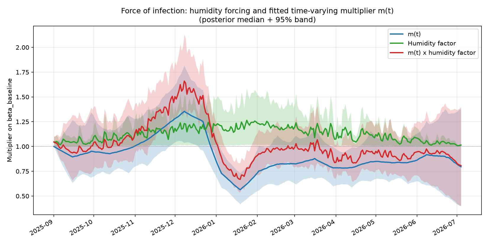

*Humidity factor, fitted m(t) and their product (posterior median and 95% band)*

### 2.5 Vaccination coverage

Cumulative share of each age group vaccinated by the schedule over the simulated season (after the 14-day delay):

| Age group | Population | Scheduled coverage |
|---|---:|---:|
| 0 | 68,723 | 50.6% |
| 1-4 | 287,051 | 47.8% |
| 5-12 | 625,439 | 39.5% |
| 13-17 | 406,983 | 37.6% |
| 18-49 | 3,112,693 | 27.6% |
| 50-64 | 1,351,323 | 38.1% |
| 65+ | 1,420,722 | 60.8% |
| **All** | **7,272,934** | **38.6%** |

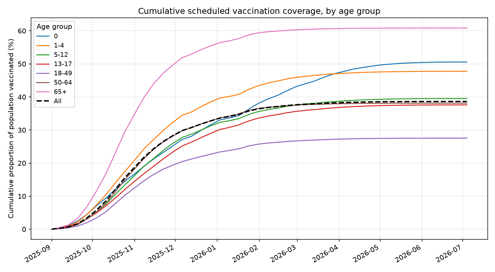

*Cumulative scheduled vaccination coverage*

---

## 3. Vaccination impact of the 2025–2026 programme

The fitted baseline produces a median of **8,268** hospitalizations across all ages, against **22,545** with no vaccination.

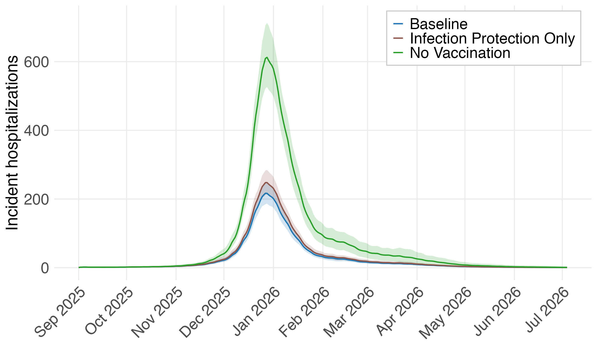

*Daily hospitalizations: baseline, infection protection only, no vaccination*

### Table S.A.1 — Hospitalizations averted, infection vs. severity protection

**Infection protection** (no vaccination → VE against infection only)

| Age group | Hospitalizations averted | % averted | Per 100,000 population | Per 100,000 doses |
|---|---:|---:|---:|---:|
| 0 | 150 [108 – 187] | 63.4% [58.0% – 66.7%] | 218.0 [156.8 – 272.5] | 431.0 [310.0 – 538.9] |
| 1-4 | 578 [397 – 746] | 64.5% [58.9% – 68.0%] | 201.2 [138.2 – 259.8] | 421.3 [289.5 – 543.9] |
| 5-12 | 598 [411 – 851] | 62.8% [56.3% – 66.8%] | 95.7 [65.7 – 136.1] | 242.0 [166.2 – 344.1] |
| 13-17 | 199 [126 – 274] | 61.8% [55.1% – 65.9%] | 48.9 [31.0 – 67.4] | 130.0 [82.5 – 179.2] |
| 18-49 | 1,396 [1,023 – 1,859] | 58.4% [51.8% – 62.3%] | 44.9 [32.9 – 59.7] | 162.8 [119.2 – 216.7] |
| 50-64 | 1,672 [1,225 – 2,199] | 59.5% [53.3% – 63.2%] | 123.7 [90.6 – 162.7] | 324.5 [237.7 – 426.8] |
| 65+ | 8,492 [6,508 – 10,274] | 57.2% [51.1% – 60.9%] | 597.7 [458.1 – 723.2] | 982.4 [752.9 – 1188.6] |
| **All** | **13,178 [10,271 – 15,701]** | **58.2% [52.1% – 62.0%]** | **181.2 [141.2 – 215.9]** | **469.1 [365.6 – 558.9]** |

**Severity protection** (adding VE against hospitalization given infection)

| Age group | Hospitalizations averted | % averted | Per 100,000 population | Per 100,000 doses |
|---|---:|---:|---:|---:|
| 0 | 2 [1 – 2] | 0.7% [0.6% – 0.8%] | 2.4 [1.5 – 3.5] | 4.7 [3.1 – 6.9] |
| 1-4 | 7 [5 – 9] | 0.8% [0.7% – 1.0%] | 2.6 [1.8 – 3.2] | 5.4 [3.8 – 6.7] |
| 5-12 | 7 [5 – 8] | 0.7% [0.6% – 0.8%] | 1.1 [0.8 – 1.3] | 2.7 [1.9 – 3.4] |
| 13-17 | 2 [1 – 3] | 0.6% [0.6% – 0.8%] | 0.5 [0.3 – 0.7] | 1.3 [0.9 – 1.7] |
| 18-49 | 17 [14 – 21] | 0.7% [0.6% – 0.8%] | 0.5 [0.4 – 0.7] | 2.0 [1.6 – 2.4] |
| 50-64 | 29 [24 – 35] | 1.0% [0.9% – 1.2%] | 2.1 [1.8 – 2.6] | 5.5 [4.6 – 6.7] |
| 65+ | 1,098 [991 – 1,193] | 7.4% [6.7% – 8.4%] | 77.3 [69.8 – 84.0] | 127.0 [114.7 – 138.0] |
| **All** | **1,161 [1,056 – 1,255]** | **5.1% [4.6% – 5.9%]** | **16.0 [14.5 – 17.3]** | **41.3 [37.6 – 44.7]** |

**Total** (no vaccination → baseline)

| Age group | Hospitalizations averted | % averted | Per 100,000 population | Per 100,000 doses |
|---|---:|---:|---:|---:|
| 0 | 151 [109 – 189] | 64.0% [58.8% – 67.3%] | 220.3 [158.3 – 275.7] | 435.8 [313.1 – 545.3] |
| 1-4 | 585 [402 – 754] | 65.3% [59.9% – 68.7%] | 203.8 [140.2 – 262.8] | 426.9 [293.6 – 550.3] |
| 5-12 | 605 [417 – 859] | 63.5% [57.1% – 67.4%] | 96.8 [66.7 – 137.4] | 244.7 [168.6 – 347.5] |
| 13-17 | 201 [128 – 277] | 62.5% [55.9% – 66.5%] | 49.4 [31.4 – 68.1] | 131.3 [83.5 – 181.0] |
| 18-49 | 1,414 [1,039 – 1,879] | 59.1% [52.6% – 63.0%] | 45.4 [33.4 – 60.4] | 164.9 [121.2 – 219.1] |
| 50-64 | 1,700 [1,250 – 2,233] | 60.5% [54.4% – 64.1%] | 125.8 [92.5 – 165.3] | 330.0 [242.6 – 433.5] |
| 65+ | 9,585 [7,553 – 11,402] | 64.5% [59.5% – 67.6%] | 674.6 [531.7 – 802.5] | 1108.8 [873.8 – 1319.0] |
| **All** | **14,346 [11,362 – 16,901]** | **63.4% [58.0% – 66.7%]** | **197.3 [156.2 – 232.4]** | **510.7 [404.4 – 601.6]** |

### Table S.A.2 — Hospitalizations averted by age group vaccinated

Each column vaccinates one age group only (all others unvaccinated) and compares with no vaccination; `All` is the full baseline schedule. Rows are the age group in which hospitalizations are counted, so off-diagonal cells are indirect protection.

**Hospitalizations averted**

| Counted in | 0 vacc. | 1-4 vacc. | 5-12 vacc. | 13-17 vacc. | 18-49 vacc. | 50-64 vacc. | 65+ vacc. | All vacc. |
|---|---:|---:|---:|---:|---:|---:|---:|---:|
| 0 | 38 [26 – 48] | 14 [10 – 17] | 48 [34 – 57] | 30 [21 – 36] | 46 [33 – 56] | 21 [15 – 25] | 0 [-0 – 0] | 151 [109 – 189] |
| 1-4 | 5 [3 – 6] | 207 [144 – 266] | 189 [124 – 253] | 109 [70 – 148] | 165 [108 – 220] | 77 [49 – 103] | 0 [-0 – 0] | 585 [402 – 754] |
| 5-12 | 4 [3 – 6] | 48 [31 – 72] | 325 [223 – 468] | 114 [72 – 173] | 155 [99 – 232] | 73 [46 – 111] | 0 [-0 – 0] | 605 [417 – 859] |
| 13-17 | 1 [1 – 2] | 14 [8 – 20] | 59 [34 – 85] | 89 [57 – 123] | 53 [31 – 77] | 26 [15 – 38] | 0 [-0 – 0] | 201 [128 – 277] |
| 18-49 | 12 [8 – 16] | 120 [82 – 170] | 449 [302 – 631] | 299 [199 – 425] | 569 [408 – 778] | 221 [151 – 310] | 0 [-0 – 0] | 1,414 [1,039 – 1,879] |
| 50-64 | 13 [9 – 18] | 135 [92 – 189] | 524 [354 – 726] | 358 [241 – 499] | 531 [364 – 733] | 515 [379 – 680] | 0 [-0 – 0] | 1,700 [1,250 – 2,233] |
| 65+ | 71 [51 – 92] | 757 [544 – 971] | 2,877 [2,049 – 3,671] | 1,927 [1,364 – 2,479] | 2,824 [2,045 – 3,577] | 1,507 [1,101 – 1,907] | 2,586 [2,184 – 2,942] | 9,585 [7,553 – 11,402] |
| **All** | **144 [117 – 167]** | **1,297 [954 – 1,632]** | **4,504 [3,241 – 5,672]** | **2,948 [2,094 – 3,736]** | **4,371 [3,217 – 5,483]** | **2,465 [1,846 – 3,065]** | **2,586 [2,184 – 2,942]** | **14,346 [11,362 – 16,901]** |

**% reduction**

| Counted in | 0 vacc. | 1-4 vacc. | 5-12 vacc. | 13-17 vacc. | 18-49 vacc. | 50-64 vacc. | 65+ vacc. | All vacc. |
|---|---:|---:|---:|---:|---:|---:|---:|---:|
| 0 | 15.8% [15.2% – 16.3%] | 5.8% [5.0% – 6.6%] | 20.0% [16.6% – 22.5%] | 12.6% [10.3% – 14.4%] | 19.4% [16.3% – 21.7%] | 8.9% [7.4% – 10.1%] | 0.0% [-0.0% – 0.0%] | 64.0% [58.8% – 67.3%] |
| 1-4 | 0.5% [0.4% – 0.6%] | 23.1% [21.9% – 24.1%] | 21.1% [17.4% – 23.9%] | 12.2% [9.8% – 14.1%] | 18.3% [15.1% – 20.8%] | 8.5% [7.0% – 9.8%] | 0.0% [-0.0% – 0.0%] | 65.3% [59.9% – 68.7%] |
| 5-12 | 0.4% [0.3% – 0.5%] | 5.1% [4.1% – 5.9%] | 34.2% [30.3% – 37.1%] | 12.0% [9.4% – 14.2%] | 16.3% [12.9% – 19.0%] | 7.7% [6.1% – 9.1%] | 0.0% [-0.0% – 0.0%] | 63.5% [57.1% – 67.4%] |
| 13-17 | 0.4% [0.3% – 0.5%] | 4.3% [3.3% – 5.1%] | 18.1% [14.3% – 21.2%] | 27.5% [24.6% – 29.9%] | 16.4% [13.0% – 19.1%] | 8.1% [6.4% – 9.4%] | 0.0% [-0.0% – 0.0%] | 62.5% [55.9% – 66.5%] |
| 18-49 | 0.5% [0.4% – 0.6%] | 5.0% [4.1% – 5.7%] | 18.6% [15.1% – 21.4%] | 12.4% [9.9% – 14.3%] | 23.7% [20.5% – 26.2%] | 9.2% [7.5% – 10.5%] | 0.0% [-0.0% – 0.0%] | 59.1% [52.6% – 63.0%] |
| 50-64 | 0.4% [0.4% – 0.5%] | 4.8% [3.9% – 5.5%] | 18.4% [15.0% – 21.1%] | 12.6% [10.2% – 14.5%] | 18.7% [15.5% – 21.1%] | 18.3% [16.6% – 19.6%] | 0.0% [-0.0% – 0.0%] | 60.5% [54.4% – 64.1%] |
| 65+ | 0.5% [0.4% – 0.5%] | 5.1% [4.3% – 5.8%] | 19.3% [16.1% – 21.8%] | 13.0% [10.7% – 14.7%] | 19.0% [16.0% – 21.3%] | 10.1% [8.6% – 11.3%] | 17.4% [17.2% – 17.5%] | 64.5% [59.5% – 67.6%] |
| **All** | **0.6% [0.6% – 0.7%]** | **5.8% [4.9% – 6.5%]** | **19.8% [16.5% – 22.4%]** | **13.0% [10.7% – 14.8%]** | **19.3% [16.2% – 21.7%]** | **10.9% [9.3% – 12.1%]** | **11.5% [10.8% – 12.0%]** | **63.4% [58.0% – 66.7%]** |

**Per 100,000 doses given to the column's age group**

| Counted in | 0 vacc. | 1-4 vacc. | 5-12 vacc. | 13-17 vacc. | 18-49 vacc. | 50-64 vacc. | 65+ vacc. | All vacc. |
|---|---:|---:|---:|---:|---:|---:|---:|---:|
| 0 | 107.9 [76.2 – 137.4] | 10.1 [7.2 – 12.2] | 19.2 [13.7 – 23.0] | 19.6 [14.0 – 23.2] | 5.4 [3.8 – 6.5] | 4.1 [2.9 – 4.9] | 0.0 [-0.0 – 0.0] | 435.8 [313.1 – 545.3] |
| 1-4 | 13.8 [9.1 – 18.5] | 150.9 [104.9 – 194.0] | 76.5 [50.2 – 102.2] | 71.4 [45.7 – 96.6] | 19.2 [12.5 – 25.7] | 14.9 [9.6 – 20.0] | 0.0 [-0.0 – 0.0] | 426.9 [293.6 – 550.3] |
| 5-12 | 11.6 [7.4 – 17.5] | 35.1 [22.6 – 52.5] | 131.6 [90.2 – 189.4] | 74.6 [46.8 – 113.1] | 18.1 [11.5 – 27.1] | 14.2 [9.0 – 21.5] | 0.0 [-0.0 – 0.0] | 244.7 [168.6 – 347.5] |
| 13-17 | 3.7 [2.1 – 5.4] | 10.1 [5.8 – 14.9] | 23.7 [13.7 – 34.5] | 58.0 [37.1 – 80.3] | 6.2 [3.6 – 9.0] | 5.1 [3.0 – 7.4] | 0.0 [-0.0 – 0.0] | 131.3 [83.5 – 181.0] |
| 18-49 | 33.4 [22.7 – 47.0] | 87.9 [59.5 – 123.8] | 181.6 [122.1 – 255.4] | 195.1 [130.0 – 277.5] | 66.3 [47.6 – 90.7] | 42.9 [29.2 – 60.2] | 0.0 [-0.0 – 0.0] | 164.9 [121.2 – 219.1] |
| 50-64 | 36.3 [24.5 – 50.9] | 98.7 [66.9 – 138.0] | 212.1 [143.0 – 293.7] | 233.6 [157.2 – 326.3] | 61.9 [42.5 – 85.5] | 99.9 [73.6 – 132.0] | 0.0 [-0.0 – 0.0] | 330.0 [242.6 – 433.5] |
| 65+ | 204.4 [147.6 – 263.4] | 552.2 [396.6 – 708.0] | 1163.6 [828.7 – 1484.7] | 1259.2 [891.2 – 1619.4] | 329.3 [238.5 – 417.1] | 292.5 [213.7 – 370.0] | 299.2 [252.6 – 340.3] | 1108.8 [873.8 – 1319.0] |
| **All** | **414.4 [335.7 – 481.0]** | **946.2 [696.0 – 1190.8]** | **1821.3 [1310.7 – 2293.8]** | **1926.1 [1368.3 – 2440.6]** | **509.7 [375.1 – 639.3]** | **478.5 [358.4 – 594.8]** | **299.2 [252.6 – 340.3]** | **510.7 [404.4 – 601.6]** |

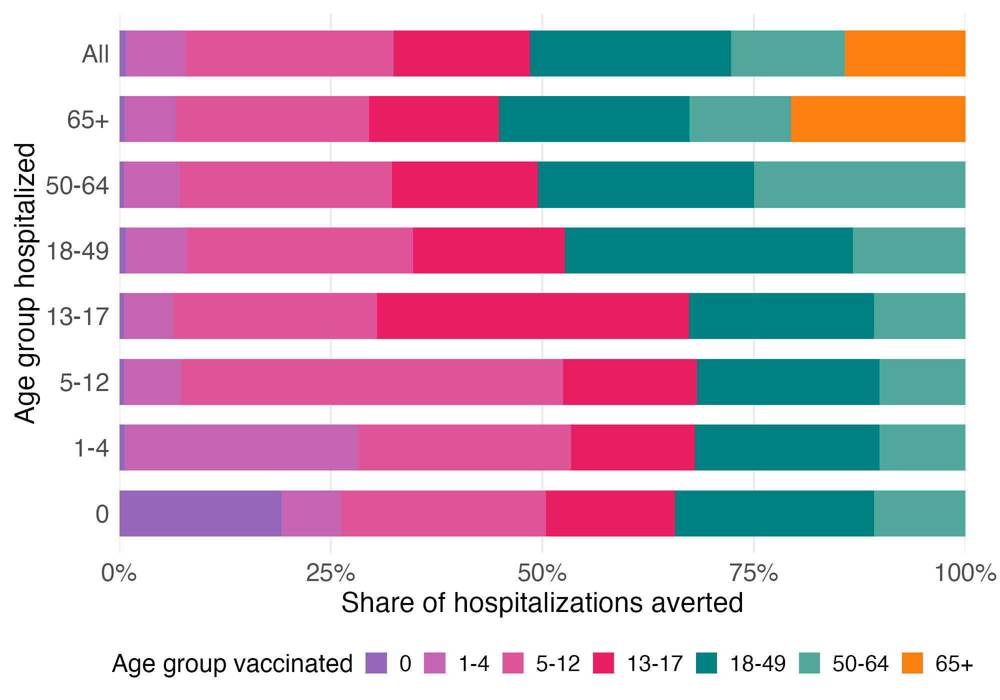

*Share of each age group's averted hospitalizations, by age group vaccinated*

### Table S.A.4 — Vaccine-effectiveness sensitivity scenarios

| Scenario | Age group | VE_infection | VE_hosp_infection | VE_hosp_given_infection | VE_transmission_blocking |
|---|---|---:|---:|---:|---:|
| low_ve | 0 | 33% | 33% | 0% | 0% |
| low_ve | 1-4 | 33% | 33% | 0% | 0% |
| low_ve | 5-12 | 33% | 33% | 0% | 0% |
| low_ve | 13-17 | 33% | 33% | 0% | 0% |
| low_ve | 18-49 | 6% | 10% | 4% | 0% |
| low_ve | 50-64 | 6% | 10% | 4% | 0% |
| low_ve | 65+ | 0% | 21% | 21% | 0% |
| baseline_ve | 0 | 43% | 48% | 9% | 0% |
| baseline_ve | 1-4 | 43% | 48% | 9% | 0% |
| baseline_ve | 5-12 | 43% | 48% | 9% | 0% |
| baseline_ve | 13-17 | 43% | 48% | 9% | 0% |
| baseline_ve | 18-49 | 21% | 28% | 9% | 0% |
| baseline_ve | 50-64 | 21% | 28% | 9% | 0% |
| baseline_ve | 65+ | 0% | 31% | 31% | 0% |
| high_ve | 0 | 51% | 78% | 55% | 0% |
| high_ve | 1-4 | 51% | 78% | 55% | 0% |
| high_ve | 5-12 | 51% | 78% | 55% | 0% |
| high_ve | 13-17 | 51% | 78% | 55% | 0% |
| high_ve | 18-49 | 34% | 44% | 16% | 0% |
| high_ve | 50-64 | 34% | 44% | 16% | 0% |
| high_ve | 65+ | 14% | 39% | 29% | 0% |

### Table S.A.5 — Hospitalizations averted across VE scenarios (vs. no vaccination)

**Hospitalizations averted**

| Age group | Low VE | Baseline VE | High VE |
|---|---:|---:|---:|
| 0 | 101 [71 – 125] | 151 [109 – 189] | 186 [131 – 235] |
| 1-4 | 399 [270 – 521] | 585 [402 – 754] | 714 [499 – 913] |
| 5-12 | 408 [277 – 591] | 605 [417 – 859] | 743 [517 – 1,033] |
| 13-17 | 135 [84 – 188] | 201 [128 – 277] | 248 [162 – 336] |
| 18-49 | 864 [605 – 1,190] | 1,414 [1,039 – 1,879] | 1,764 [1,337 – 2,302] |
| 50-64 | 1,036 [727 – 1,405] | 1,700 [1,250 – 2,233] | 2,115 [1,596 – 2,738] |
| 65+ | 6,409 [4,888 – 7,807] | 9,585 [7,553 – 11,402] | 11,563 [9,403 – 13,462] |
| **All** | **9,420 [7,195 – 11,405]** | **14,346 [11,362 – 16,901]** | **17,393 [14,179 – 20,176]** |

**% reduction**

| Age group | Low VE | Baseline VE | High VE |
|---|---:|---:|---:|
| 0 | 42.9% [37.9% – 46.3%] | 64.0% [58.8% – 67.3%] | 78.5% [74.8% – 80.8%] |
| 1-4 | 44.4% [39.2% – 48.0%] | 65.3% [59.9% – 68.7%] | 79.8% [76.1% – 82.1%] |
| 5-12 | 42.9% [37.0% – 47.1%] | 63.5% [57.1% – 67.4%] | 77.8% [73.1% – 80.5%] |
| 13-17 | 41.7% [35.6% – 45.9%] | 62.5% [55.9% – 66.5%] | 76.9% [72.1% – 79.8%] |
| 18-49 | 36.1% [30.3% – 40.0%] | 59.1% [52.6% – 63.0%] | 73.6% [68.5% – 76.6%] |
| 50-64 | 36.7% [31.2% – 40.5%] | 60.5% [54.4% – 64.1%] | 75.1% [70.5% – 77.8%] |
| 65+ | 43.1% [38.5% – 46.4%] | 64.5% [59.5% – 67.6%] | 77.8% [74.0% – 80.1%] |
| **All** | **41.6% [36.6% – 45.0%]** | **63.4% [58.0% – 66.7%]** | **77.1% [73.0% – 79.6%]** |

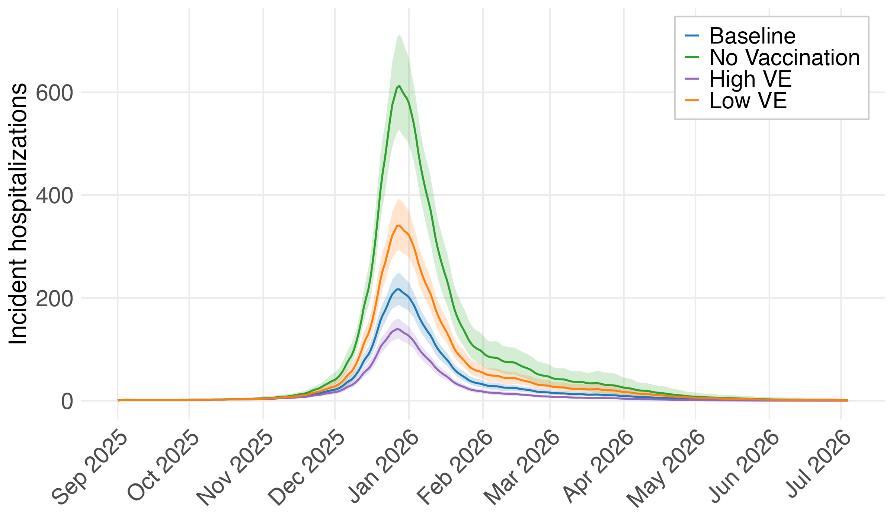

*Daily hospitalizations under low, baseline and high VE*

---

## 4. Coverage scenarios

Two families of counterfactual schedules, each applied either to **every age group at once** or to **one age group at a time** (others keep the baseline schedule), and compared with the baseline:

- **Coverage targets** (50%, 55%, 60%, 65%, 70%): each targeted group's daily doses are scaled by `target / baseline coverage`, so its season coverage reaches the target. A group already above the target keeps its schedule.

- **Fewer doses** (−5%, −10%, −15%, −20%): each targeted group's daily doses are cut by that share (a relative decrease, e.g. 60% coverage becomes 54% at −10%). Timing is unchanged.

### 4.1 All age groups together

| Scenario | Overall coverage | Doses vs. baseline | Hospitalizations | Change vs. baseline | % change |
|---|---:|---:|---:|---:|---:|
| No vaccination | 0.0% | -2,809,361 | 22,545 [19,359 – 25,445] | +14,346 [+11,362 – +16,901] | +173.1% [+138.2% – +200.2%] |
| -20% | 30.9% | -561,872 | 10,312 [9,585 – 11,034] | +2,049 [+1,773 – +2,260] | +24.8% [+22.0% – +26.7%] |
| -15% | 32.8% | -421,404 | 9,757 [9,089 – 10,431] | +1,501 [+1,308 – +1,647] | +18.2% [+16.2% – +19.4%] |
| -10% | 34.8% | -280,936 | 9,237 [8,610 – 9,845] | +976 [+856 – +1,069] | +11.8% [+10.6% – +12.6%] |
| -5% | 36.7% | -140,468 | 8,741 [8,152 – 9,309] | +476 [+419 – +519] | +5.8% [+5.2% – +6.1%] |
| Baseline | 38.6% | +0 | 8,268 [7,715 – 8,802] | +0 [+0 – +0] | +0.0% [+0.0% – +0.0%] |
| 50% target | 52.1% | +981,541 | 5,413 [5,041 – 5,828] | -2,860 [-3,087 – -2,599] | -34.6% [-36.1% – -32.4%] |
| 55% target | 56.1% | +1,273,763 | 4,687 [4,355 – 5,085] | -3,589 [-3,865 – -3,283] | -43.4% [-45.0% – -41.0%] |
| 60% target | 60.2% | +1,566,373 | 4,059 [3,764 – 4,411] | -4,219 [-4,532 – -3,874] | -51.0% [-52.6% – -48.6%] |
| 65% target | 65.0% | +1,918,046 | 3,487 [3,224 – 3,801] | -4,787 [-5,134 – -4,416] | -57.9% [-59.5% – -55.6%] |
| 70% target | 70.0% | +2,281,693 | 2,995 [2,758 – 3,262] | -5,279 [-5,665 – -4,881] | -63.8% [-65.3% – -61.7%] |

Overall coverage = scheduled doses summed over all age groups ÷ total population, i.e. the population-weighted average of each age group's scheduled coverage.

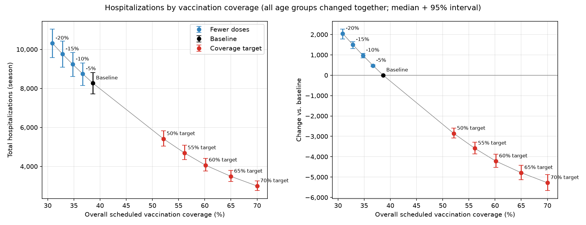

*Season hospitalizations against overall scheduled coverage*

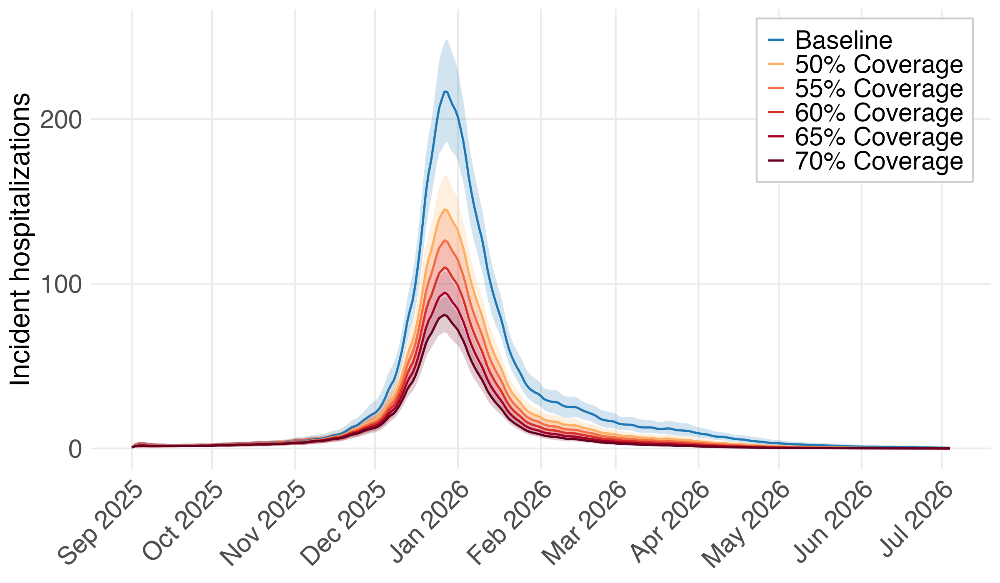

*Daily hospitalizations: baseline and coverage targets (all ages)*

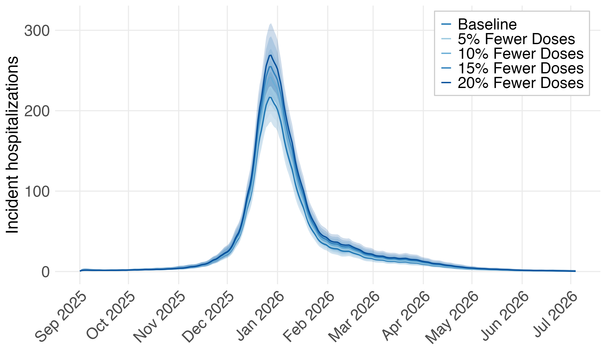

*Daily hospitalizations: baseline and fewer doses (all ages)*

### 4.2 One age group at a time

Change in **total** (all-ages) hospitalizations when only the row's age group is changed, median across draws (95% intervals in appendix A):

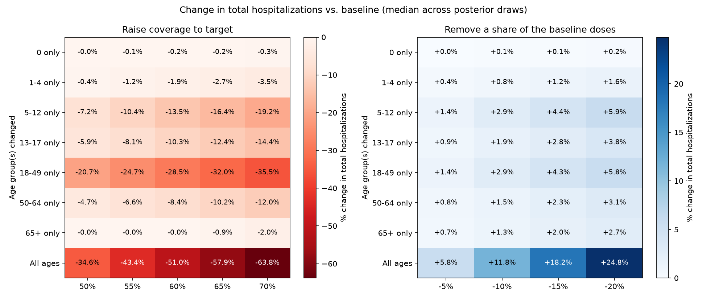

*% change in total hospitalizations, by age group changed and level*

**Hospitalizations averted vs. baseline, all ages counted**

| Raised to target | 50% | 55% | 60% | 65% | 70% |
|---|---:|---:|---:|---:|---:|
| 0 only | 0 [0 – 0] | 6 [5 – 6] | 13 [12 – 14] | 19 [18 – 21] | 26 [24 – 28] |
| 1-4 only | 30 [26 – 32] | 95 [85 – 104] | 161 [143 – 175] | 225 [200 – 246] | 289 [257 – 315] |
| 5-12 only | 593 [520 – 651] | 859 [756 – 940] | 1,112 [982 – 1,215] | 1,354 [1,199 – 1,477] | 1,587 [1,410 – 1,730] |
| 13-17 only | 488 [425 – 533] | 672 [589 – 735] | 851 [747 – 930] | 1,025 [901 – 1,119] | 1,193 [1,050 – 1,302] |
| 18-49 only | 1,704 [1,536 – 1,850] | 2,034 [1,841 – 2,205] | 2,349 [2,128 – 2,539] | 2,647 [2,401 – 2,857] | 2,927 [2,669 – 3,159] |
| 50-64 only | 385 [341 – 421] | 541 [480 – 592] | 693 [617 – 758] | 844 [752 – 921] | 990 [884 – 1,081] |
| 65+ only | 0 [0 – 0] | 0 [0 – 0] | 0 [0 – 0] | 75 [68 – 82] | 165 [149 – 180] |
| All ages | 2,860 [2,599 – 3,087] | 3,589 [3,283 – 3,865] | 4,219 [3,874 – 4,532] | 4,787 [4,416 – 5,134] | 5,279 [4,881 – 5,665] |

**Additional hospitalizations vs. baseline, all ages counted**

| Doses cut | −5% | −10% | −15% | −20% |
|---|---:|---:|---:|---:|
| 0 only | 3 [3 – 4] | 7 [6 – 7] | 10 [9 – 11] | 14 [12 – 15] |
| 1-4 only | 32 [28 – 35] | 64 [57 – 70] | 96 [85 – 104] | 128 [114 – 140] |
| 5-12 only | 118 [102 – 130] | 239 [206 – 263] | 361 [312 – 399] | 486 [418 – 537] |
| 13-17 only | 77 [67 – 85] | 156 [134 – 171] | 235 [202 – 259] | 316 [271 – 347] |
| 18-49 only | 117 [103 – 129] | 236 [206 – 259] | 356 [311 – 392] | 479 [416 – 526] |
| 50-64 only | 64 [56 – 70] | 128 [112 – 140] | 192 [169 – 211] | 257 [226 – 283] |
| 65+ only | 55 [50 – 60] | 110 [99 – 119] | 165 [149 – 179] | 220 [198 – 239] |
| All ages | 476 [419 – 519] | 976 [856 – 1,069] | 1,501 [1,308 – 1,647] | 2,049 [1,773 – 2,260] |

### 4.3 Efficiency per dose

Hospitalizations averted per 100,000 **additional** doses (targets) and added per 100,000 doses **removed** (cuts), all ages counted. For targets the denominator is the extra doses the target requires in that group (`All ages`: in every group).

| Age group changed | 50% target | 55% target | 60% target | 65% target | 70% target | −5% | −10% | −15% | −20% |
|---|---:|---:|---:|---:|---:|---:|---:|---:|---:|
| 0 only | — | 196.7 [179.4 – 211.1] | 195.9 [178.7 – 210.0] | 196.0 [178.9 – 210.3] | 195.7 [178.5 – 209.9] | 194.9 [177.7 – 209.2] | 193.3 [176.6 – 207.4] | 195.8 [178.9 – 210.1] | 195.1 [178.0 – 209.2] |
| 1-4 only | 460.4 [409.0 – 501.7] | 458.9 [408.0 – 500.8] | 457.2 [406.5 – 499.0] | 454.8 [404.5 – 496.3] | 452.6 [402.5 – 493.8] | 462.5 [411.3 – 505.1] | 464.1 [413.5 – 507.1] | 465.1 [414.4 – 508.2] | 466.8 [415.4 – 509.7] |
| 5-12 only | 907.0 [794.6 – 994.5] | 887.8 [782.1 – 971.5] | 868.9 [767.7 – 949.4] | 850.5 [753.0 – 927.6] | 832.8 [739.8 – 907.9] | 957.2 [828.8 – 1054.6] | 964.7 [833.9 – 1064.3] | 973.7 [840.2 – 1075.1] | 981.7 [845.6 – 1085.1] |
| 13-17 only | 967.1 [843.0 – 1056.4] | 950.2 [831.8 – 1038.0] | 934.3 [820.0 – 1020.7] | 919.1 [808.5 – 1003.9] | 905.2 [796.6 – 987.7] | 1011.1 [870.8 – 1108.1] | 1020.4 [877.2 – 1119.3] | 1025.7 [881.1 – 1126.6] | 1030.9 [885.3 – 1133.8] |
| 18-49 only | 243.8 [219.8 – 264.7] | 238.1 [215.5 – 258.1] | 232.5 [210.7 – 251.4] | 227.0 [206.0 – 245.1] | 221.5 [202.0 – 239.0] | 273.6 [239.2 – 300.3] | 275.3 [240.4 – 302.4] | 277.1 [241.5 – 304.6] | 279.1 [242.7 – 306.9] |
| 50-64 only | 239.7 [212.4 – 262.3] | 237.1 [210.7 – 259.5] | 234.6 [208.8 – 256.5] | 232.3 [207.0 – 253.7] | 229.9 [205.2 – 250.9] | 246.8 [217.7 – 270.8] | 247.7 [218.3 – 271.8] | 248.6 [218.9 – 273.0] | 249.6 [219.6 – 274.2] |
| 65+ only | — | — | — | 127.0 [114.7 – 138.0] | 127.0 [114.7 – 138.0] | 127.0 [114.7 – 138.0] | 127.0 [114.7 – 138.0] | 127.0 [114.7 – 138.0] | 127.0 [114.7 – 138.0] |
| All ages | 291.4 [264.8 – 314.6] | 281.8 [257.8 – 303.5] | 269.3 [247.3 – 289.3] | 249.6 [230.2 – 267.7] | 231.4 [213.9 – 248.3] | 338.8 [298.2 – 369.4] | 347.6 [304.6 – 380.4] | 356.1 [310.3 – 390.9] | 364.6 [315.5 – 402.2] |

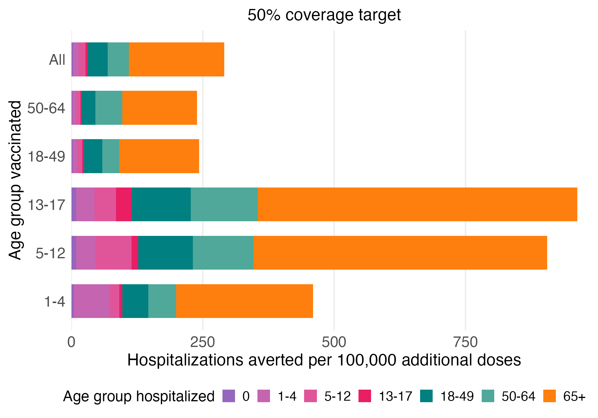

*50% target: hospitalizations averted per 100,000 additional doses, by age group hospitalized*

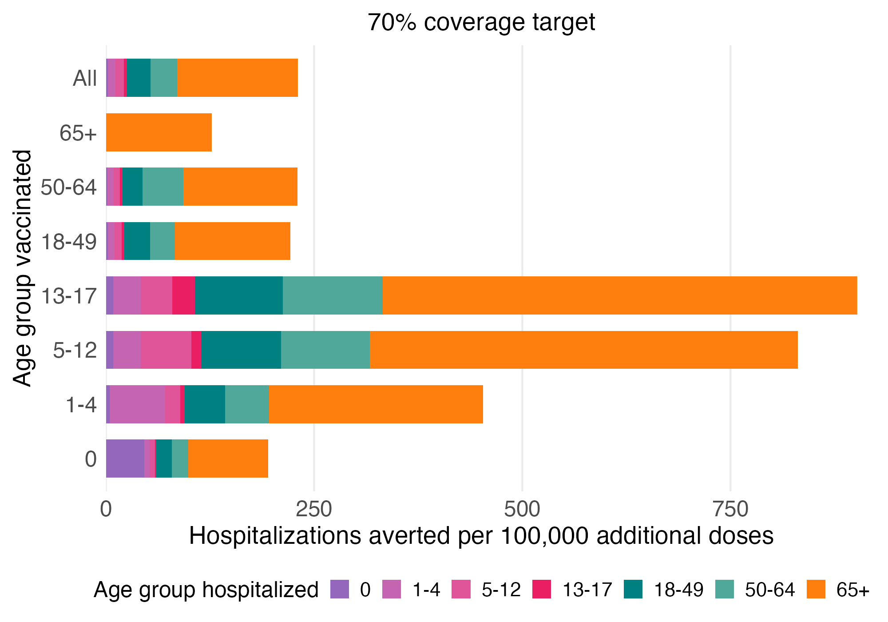

*70% target: hospitalizations averted per 100,000 additional doses, by age group hospitalized*

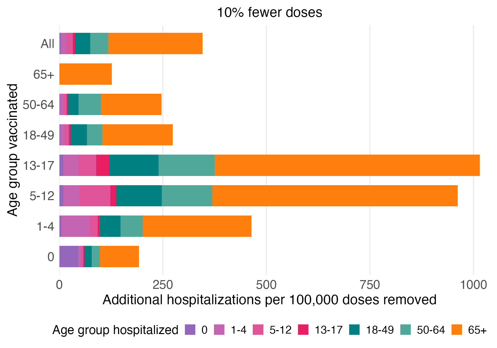

*10% fewer doses: additional hospitalizations per 100,000 doses removed*

A relative dose cut removes the most doses where coverage is highest, so per removed dose its cost mirrors the per-dose benefit of Table S.A.2; coverage targets add doses mostly to the least-covered groups (18-49 needs the largest relative increase).

---

## 5. Baseline fit check

Cumulative admissions over 2025-09-01 – 2026-07-04:

| Age group | Simulated (median) | Simulated 95% interval | Observed | % difference |
|---|---:|---:|---:|---:|
| 0 | 85.1 | 55.2 – 124.4 | 114.0 | -25.4% |
| 1-4 | 308.3 | 222.4 – 387.1 | 302.9 | +1.8% |
| 5-12 | 353.5 | 253.9 – 450.6 | 347.0 | +1.9% |
| 13-17 | 120.8 | 81.0 – 155.9 | 123.0 | -1.8% |
| 18-49 | 986.7 | 794.1 – 1,188.9 | 984.7 | +0.2% |
| 50-64 | 1,116.1 | 927.5 – 1,361.1 | 1,108.7 | +0.7% |
| 65+ | 5,290.8 | 4,776.1 – 5,750.6 | 5,388.9 | -1.8% |
| **Total** | **8,268.0** | **7,714.8 – 8,802.1** | **8,369.1** | **-1.2%** |

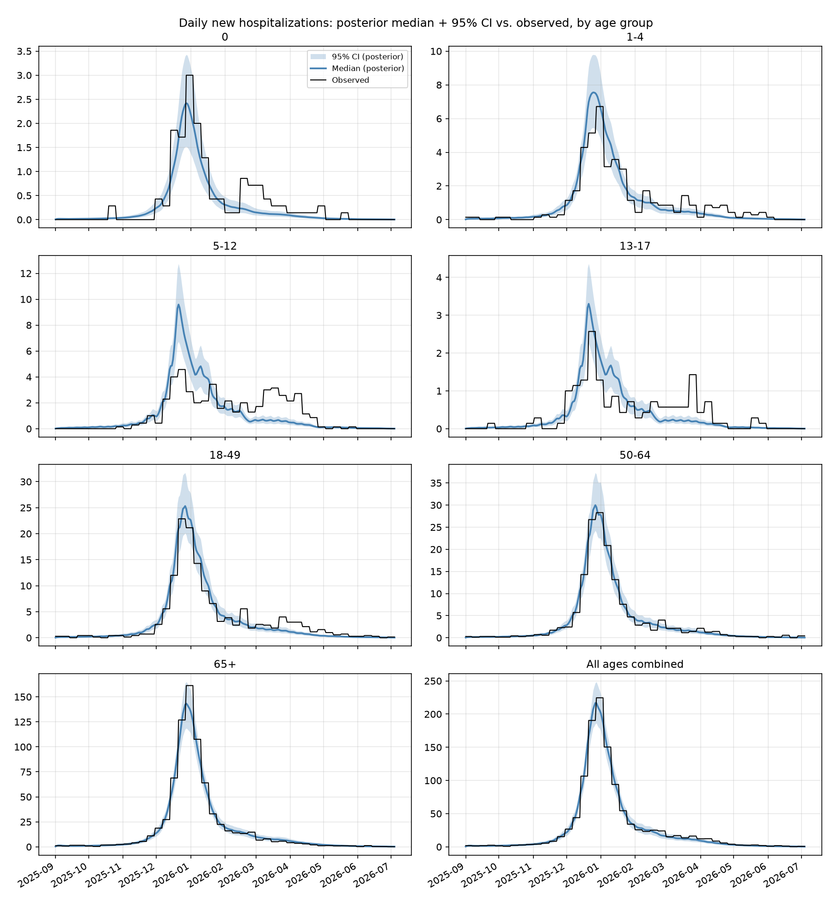

*Daily admissions: posterior median and 95% band vs. observed*

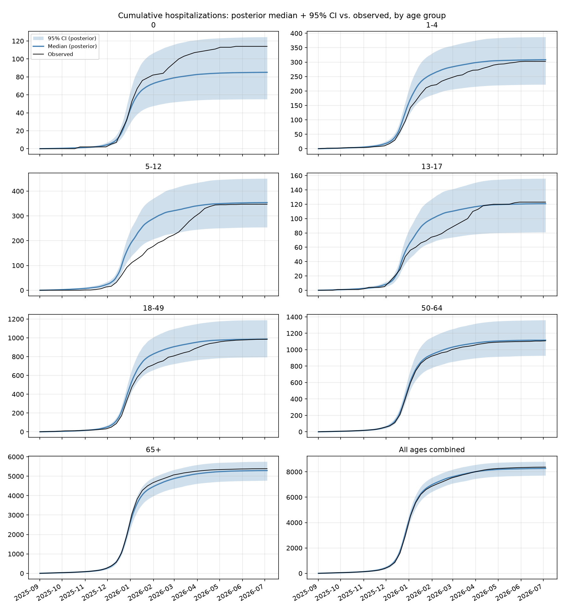

*Cumulative admissions: posterior median and 95% band vs. observed*

---

## 6. Data sources

| Input | Source |
|---|---|
| Hospital admissions (calibration target) | Massachusetts Department of Public Health (MA DPH): weekly influenza admissions by county and age group (`influenza_timeseries_*.csv`, `ed_admits_count`), summed over counties and spread evenly over each MMWR week (`data/prepare_hospitalizations.py`) |
| Vaccination | MA DPH: weekly cumulative first doses by county and age (`MA_influenza_coverage_2025-2026.csv`), differenced and spread over each week (`data/prepare_vaccination.py`) |
| Population by age group | MA DPH: `POP_ESTIMATE` of the vaccination file, summed over counties |
| Contact matrices | Mistry et al. 2021 synthetic contact matrices |
| Absolute humidity | gridMET daily specific humidity averaged over Massachusetts (× 1.2 kg/m³, `data/extract_ma_humidity.py`) |
| School/work calendar | Constructed state school/work-day calendar |

## 7. Notes

- Intervals reflect calibration uncertainty (posterior draws, deterministic transitions), not epidemic-process noise.
- `m(t)` is a statistical smoothing device, not an independently measured behavioural signal.
- Coverage-target multipliers are computed from the scheduled coverage over the simulated window; the model's cap means delivered coverage lands slightly below the target (appendix B).
- "Per 100,000 doses" uses scheduled doses: doses the model declines to deliver to already-infected people are still bought and given.
- Vaccinating 65+ has no indirect effect on other age groups because vaccination blocks no infection in 65+ in the fitted model (residual susceptibility 1.00).

---

## Appendix A — Coverage-scenario tables by age group hospitalized

### 50% coverage target — hospitalizations averted vs. baseline

| Counted in | 0 raised | 1-4 raised | 5-12 raised | 13-17 raised | 18-49 raised | 50-64 raised | 65+ raised | All raised |
|---|---:|---:|---:|---:|---:|---:|---:|---:|
| 0 | 0 [0 – 0] | 0 [0 – 0] | 6 [4 – 8] | 5 [3 – 7] | 18 [12 – 24] | 3 [2 – 4] | 0 [0 – 0] | 29 [19 – 40] |
| 1-4 | 0 [0 – 0] | 4 [3 – 5] | 24 [17 – 30] | 18 [12 – 22] | 62 [45 – 78] | 12 [9 – 15] | 0 [0 – 0] | 106 [77 – 133] |
| 5-12 | 0 [0 – 0] | 1 [1 – 2] | 45 [32 – 58] | 20 [15 – 27] | 66 [47 – 87] | 13 [9 – 17] | 0 [0 – 0] | 128 [92 – 166] |
| 13-17 | 0 [0 – 0] | 0 [0 – 0] | 8 [6 – 11] | 15 [10 – 19] | 23 [15 – 30] | 5 [3 – 6] | 0 [0 – 0] | 45 [30 – 59] |
| 18-49 | 0 [0 – 0] | 3 [3 – 4] | 68 [53 – 84] | 57 [45 – 70] | 243 [195 – 296] | 40 [32 – 49] | 0 [0 – 0] | 368 [294 – 446] |
| 50-64 | 0 [0 – 0] | 3 [3 – 4] | 75 [60 – 94] | 64 [51 – 81] | 226 [183 – 281] | 83 [68 – 102] | 0 [0 – 0] | 401 [327 – 494] |
| 65+ | 0 [0 – 0] | 17 [15 – 19] | 366 [316 – 408] | 307 [265 – 342] | 1,063 [944 – 1,176] | 228 [200 – 253] | 0 [0 – 0] | 1,779 [1,592 – 1,959] |
| **All** | **0 [0 – 0]** | **30 [26 – 32]** | **593 [520 – 651]** | **488 [425 – 533]** | **1,704 [1,536 – 1,850]** | **385 [341 – 421]** | **0 [0 – 0]** | **2,860 [2,599 – 3,087]** |

### 55% coverage target — hospitalizations averted vs. baseline

| Counted in | 0 raised | 1-4 raised | 5-12 raised | 13-17 raised | 18-49 raised | 50-64 raised | 65+ raised | All raised |
|---|---:|---:|---:|---:|---:|---:|---:|---:|
| 0 | 1 [1 – 2] | 1 [1 – 1] | 9 [6 – 12] | 7 [5 – 9] | 21 [14 – 29] | 5 [3 – 6] | 0 [0 – 0] | 37 [25 – 52] |
| 1-4 | 0 [0 – 0] | 14 [10 – 18] | 34 [25 – 43] | 24 [17 – 30] | 74 [53 – 93] | 17 [12 – 21] | 0 [0 – 0] | 137 [99 – 172] |
| 5-12 | 0 [0 – 0] | 4 [3 – 5] | 64 [46 – 84] | 28 [20 – 37] | 79 [57 – 103] | 18 [13 – 24] | 0 [0 – 0] | 162 [117 – 209] |
| 13-17 | 0 [0 – 0] | 1 [1 – 2] | 12 [8 – 16] | 20 [14 – 27] | 27 [18 – 36] | 6 [4 – 9] | 0 [0 – 0] | 56 [37 – 73] |
| 18-49 | 1 [0 – 1] | 10 [8 – 13] | 98 [78 – 122] | 78 [62 – 97] | 289 [232 – 351] | 57 [45 – 69] | 0 [0 – 0] | 456 [366 – 550] |
| 50-64 | 1 [0 – 1] | 11 [9 – 14] | 109 [87 – 136] | 89 [71 – 111] | 271 [219 – 335] | 116 [95 – 143] | 0 [0 – 0] | 502 [412 – 616] |
| 65+ | 3 [3 – 3] | 54 [47 – 60] | 529 [459 – 589] | 423 [366 – 471] | 1,270 [1,133 – 1,401] | 321 [283 – 356] | 0 [0 – 0] | 2,233 [2,005 – 2,455] |
| **All** | **6 [5 – 6]** | **95 [85 – 104]** | **859 [756 – 940]** | **672 [589 – 735]** | **2,034 [1,841 – 2,205]** | **541 [480 – 592]** | **0 [0 – 0]** | **3,589 [3,283 – 3,865]** |

### 60% coverage target — hospitalizations averted vs. baseline

| Counted in | 0 raised | 1-4 raised | 5-12 raised | 13-17 raised | 18-49 raised | 50-64 raised | 65+ raised | All raised |
|---|---:|---:|---:|---:|---:|---:|---:|---:|
| 0 | 3 [2 – 4] | 2 [1 – 2] | 11 [8 – 16] | 8 [6 – 11] | 24 [16 – 33] | 6 [4 – 8] | 0 [0 – 0] | 44 [29 – 62] |
| 1-4 | 0 [0 – 1] | 24 [17 – 30] | 44 [32 – 56] | 31 [22 – 39] | 85 [62 – 107] | 21 [15 – 27] | 0 [0 – 0] | 163 [118 – 204] |
| 5-12 | 0 [0 – 1] | 6 [5 – 9] | 83 [60 – 107] | 36 [26 – 47] | 92 [66 – 120] | 23 [17 – 31] | 0 [0 – 0] | 191 [137 – 246] |
| 13-17 | 0 [0 – 0] | 2 [1 – 3] | 16 [11 – 21] | 26 [17 – 33] | 31 [21 – 42] | 8 [6 – 11] | 0 [0 – 0] | 66 [44 – 85] |
| 18-49 | 1 [1 – 1] | 17 [14 – 21] | 128 [101 – 157] | 99 [79 – 123] | 333 [267 – 403] | 73 [58 – 89] | 0 [0 – 0] | 531 [427 – 640] |
| 50-64 | 1 [1 – 2] | 19 [15 – 23] | 142 [114 – 177] | 113 [90 – 141] | 313 [254 – 386] | 148 [122 – 183] | 0 [0 – 0] | 590 [483 – 720] |
| 65+ | 6 [5 – 7] | 91 [79 – 101] | 686 [598 – 763] | 537 [466 – 597] | 1,466 [1,311 – 1,617] | 412 [364 – 456] | 0 [0 – 0] | 2,622 [2,363 – 2,880] |
| **All** | **13 [12 – 14]** | **161 [143 – 175]** | **1,112 [982 – 1,215]** | **851 [747 – 930]** | **2,349 [2,128 – 2,539]** | **693 [617 – 758]** | **0 [0 – 0]** | **4,219 [3,874 – 4,532]** |

### 65% coverage target — hospitalizations averted vs. baseline

| Counted in | 0 raised | 1-4 raised | 5-12 raised | 13-17 raised | 18-49 raised | 50-64 raised | 65+ raised | All raised |
|---|---:|---:|---:|---:|---:|---:|---:|---:|
| 0 | 5 [3 – 7] | 2 [2 – 3] | 14 [9 – 19] | 10 [7 – 14] | 27 [18 – 38] | 7 [5 – 10] | 0 [-0 – 0] | 50 [33 – 71] |
| 1-4 | 1 [0 – 1] | 33 [24 – 41] | 54 [39 – 68] | 37 [27 – 46] | 96 [70 – 120] | 26 [19 – 33] | 0 [-0 – 0] | 185 [134 – 232] |
| 5-12 | 1 [0 – 1] | 9 [6 – 12] | 100 [72 – 129] | 43 [31 – 57] | 103 [74 – 135] | 28 [20 – 38] | 0 [-0 – 0] | 215 [155 – 277] |
| 13-17 | 0 [0 – 0] | 3 [2 – 4] | 19 [13 – 25] | 31 [20 – 40] | 36 [24 – 47] | 10 [7 – 13] | 0 [-0 – 0] | 74 [49 – 96] |
| 18-49 | 2 [1 – 2] | 24 [19 – 30] | 155 [123 – 191] | 120 [95 – 148] | 374 [300 – 451] | 89 [71 – 108] | 0 [-0 – 0] | 594 [479 – 716] |
| 50-64 | 2 [2 – 2] | 26 [21 – 33] | 173 [139 – 215] | 136 [109 – 169] | 353 [287 – 435] | 180 [148 – 221] | 0 [-0 – 0] | 663 [545 – 810] |
| 65+ | 10 [8 – 11] | 128 [111 – 142] | 836 [730 – 928] | 646 [562 – 718] | 1,654 [1,478 – 1,819] | 502 [443 – 555] | 75 [68 – 82] | 2,995 [2,711 – 3,286] |
| **All** | **19 [18 – 21]** | **225 [200 – 246]** | **1,354 [1,199 – 1,477]** | **1,025 [901 – 1,119]** | **2,647 [2,401 – 2,857]** | **844 [752 – 921]** | **75 [68 – 82]** | **4,787 [4,416 – 5,134]** |

### 70% coverage target — hospitalizations averted vs. baseline

| Counted in | 0 raised | 1-4 raised | 5-12 raised | 13-17 raised | 18-49 raised | 50-64 raised | 65+ raised | All raised |
|---|---:|---:|---:|---:|---:|---:|---:|---:|
| 0 | 6 [4 – 9] | 3 [2 – 4] | 16 [11 – 22] | 12 [8 – 16] | 30 [20 – 42] | 9 [6 – 12] | 0 [-0 – 0] | 55 [36 – 78] |
| 1-4 | 1 [1 – 1] | 42 [31 – 53] | 63 [46 – 79] | 43 [31 – 54] | 106 [77 – 133] | 31 [22 – 39] | 0 [-0 – 0] | 204 [147 – 255] |
| 5-12 | 1 [1 – 1] | 12 [8 – 15] | 116 [84 – 150] | 50 [36 – 66] | 115 [82 – 149] | 33 [24 – 44] | 0 [-0 – 0] | 236 [169 – 303] |
| 13-17 | 0 [0 – 0] | 3 [2 – 5] | 23 [15 – 30] | 35 [23 – 46] | 39 [26 – 52] | 12 [8 – 16] | 0 [-0 – 0] | 80 [54 – 105] |
| 18-49 | 2 [2 – 3] | 31 [25 – 38] | 182 [144 – 224] | 139 [110 – 172] | 412 [331 – 498] | 105 [83 – 127] | 0 [-0 – 0] | 648 [523 – 783] |
| 50-64 | 3 [2 – 3] | 34 [27 – 42] | 203 [162 – 252] | 158 [127 – 197] | 391 [318 – 483] | 210 [173 – 259] | 0 [-0 – 0] | 727 [598 – 886] |
| 65+ | 13 [11 – 14] | 164 [143 – 182] | 980 [858 – 1,087] | 751 [655 – 835] | 1,830 [1,642 – 2,011] | 589 [522 – 652] | 165 [149 – 180] | 3,318 [3,003 – 3,634] |
| **All** | **26 [24 – 28]** | **289 [257 – 315]** | **1,587 [1,410 – 1,730]** | **1,193 [1,050 – 1,302]** | **2,927 [2,669 – 3,159]** | **990 [884 – 1,081]** | **165 [149 – 180]** | **5,279 [4,881 – 5,665]** |

### 5% fewer doses — additional hospitalizations vs. baseline

| Counted in | 0 cut | 1-4 cut | 5-12 cut | 13-17 cut | 18-49 cut | 50-64 cut | 65+ cut | All cut |
|---|---:|---:|---:|---:|---:|---:|---:|---:|
| 0 | 1 [1 – 1] | 0 [0 – 0] | 1 [1 – 2] | 1 [1 – 1] | 1 [1 – 2] | 1 [0 – 1] | 0 [-0 – 0] | 5 [3 – 7] |
| 1-4 | 0 [0 – 0] | 5 [3 – 6] | 5 [3 – 6] | 3 [2 – 3] | 4 [3 – 5] | 2 [1 – 2] | 0 [-0 – 0] | 19 [14 – 24] |
| 5-12 | 0 [0 – 0] | 1 [1 – 2] | 9 [7 – 12] | 3 [2 – 4] | 4 [3 – 6] | 2 [2 – 3] | 0 [-0 – 0] | 21 [15 – 27] |
| 13-17 | 0 [0 – 0] | 0 [0 – 1] | 2 [1 – 2] | 2 [2 – 3] | 2 [1 – 2] | 1 [1 – 1] | 0 [-0 – 0] | 7 [5 – 9] |
| 18-49 | 0 [0 – 0] | 3 [3 – 4] | 14 [11 – 17] | 9 [7 – 11] | 17 [14 – 21] | 7 [5 – 8] | 0 [-0 – 0] | 51 [40 – 63] |
| 50-64 | 0 [0 – 0] | 4 [3 – 5] | 15 [12 – 19] | 10 [8 – 13] | 15 [12 – 19] | 14 [11 – 17] | 0 [-0 – 0] | 59 [47 – 74] |
| 65+ | 2 [1 – 2] | 18 [16 – 20] | 73 [62 – 81] | 49 [42 – 54] | 73 [63 – 81] | 38 [33 – 42] | 55 [50 – 60] | 312 [274 – 347] |
| **All** | **3 [3 – 4]** | **32 [28 – 35]** | **118 [102 – 130]** | **77 [67 – 85]** | **117 [103 – 129]** | **64 [56 – 70]** | **55 [50 – 60]** | **476 [419 – 519]** |

### 10% fewer doses — additional hospitalizations vs. baseline

| Counted in | 0 cut | 1-4 cut | 5-12 cut | 13-17 cut | 18-49 cut | 50-64 cut | 65+ cut | All cut |
|---|---:|---:|---:|---:|---:|---:|---:|---:|
| 0 | 2 [1 – 2] | 1 [0 – 1] | 2 [2 – 3] | 2 [1 – 2] | 2 [2 – 3] | 1 [1 – 1] | 0 [-0 – 0] | 10 [7 – 14] |
| 1-4 | 0 [0 – 0] | 9 [7 – 12] | 10 [7 – 12] | 6 [4 – 7] | 9 [6 – 11] | 4 [3 – 5] | 0 [-0 – 0] | 39 [28 – 49] |
| 5-12 | 0 [0 – 0] | 3 [2 – 3] | 18 [13 – 24] | 7 [5 – 9] | 9 [6 – 12] | 4 [3 – 6] | 0 [-0 – 0] | 42 [30 – 56] |
| 13-17 | 0 [0 – 0] | 1 [1 – 1] | 3 [2 – 4] | 5 [3 – 6] | 3 [2 – 4] | 2 [1 – 2] | 0 [-0 – 0] | 14 [9 – 19] |
| 18-49 | 1 [1 – 1] | 7 [5 – 8] | 27 [21 – 34] | 18 [14 – 22] | 34 [27 – 42] | 13 [10 – 16] | 0 [-0 – 0] | 104 [82 – 128] |
| 50-64 | 1 [1 – 1] | 7 [6 – 9] | 30 [24 – 38] | 21 [16 – 26] | 31 [25 – 39] | 28 [23 – 34] | 0 [-0 – 0] | 121 [97 – 152] |
| 65+ | 3 [3 – 4] | 36 [31 – 40] | 147 [125 – 164] | 98 [84 – 109] | 146 [127 – 163] | 75 [66 – 84] | 110 [99 – 119] | 641 [559 – 713] |
| **All** | **7 [6 – 7]** | **64 [57 – 70]** | **239 [206 – 263]** | **156 [134 – 171]** | **236 [206 – 259]** | **128 [112 – 140]** | **110 [99 – 119]** | **976 [856 – 1,069]** |

### 15% fewer doses — additional hospitalizations vs. baseline

| Counted in | 0 cut | 1-4 cut | 5-12 cut | 13-17 cut | 18-49 cut | 50-64 cut | 65+ cut | All cut |
|---|---:|---:|---:|---:|---:|---:|---:|---:|
| 0 | 2 [2 – 3] | 1 [1 – 1] | 4 [3 – 5] | 2 [2 – 3] | 4 [3 – 5] | 2 [1 – 2] | 0 [-0 – 0] | 16 [11 – 21] |
| 1-4 | 0 [0 – 0] | 14 [10 – 18] | 15 [10 – 18] | 8 [6 – 11] | 13 [9 – 16] | 6 [4 – 7] | 0 [-0 – 0] | 60 [43 – 75] |
| 5-12 | 0 [0 – 0] | 4 [3 – 5] | 28 [20 – 37] | 10 [7 – 13] | 14 [10 – 18] | 6 [5 – 8] | 0 [-0 – 0] | 65 [47 – 86] |
| 13-17 | 0 [0 – 0] | 1 [1 – 2] | 5 [3 – 7] | 7 [5 – 10] | 5 [3 – 6] | 2 [2 – 3] | 0 [-0 – 0] | 22 [14 – 29] |
| 18-49 | 1 [1 – 1] | 10 [8 – 13] | 41 [32 – 51] | 27 [21 – 34] | 52 [41 – 64] | 20 [16 – 25] | 0 [-0 – 0] | 159 [125 – 197] |
| 50-64 | 1 [1 – 1] | 11 [9 – 14] | 46 [36 – 57] | 31 [24 – 39] | 47 [37 – 59] | 42 [34 – 52] | 0 [-0 – 0] | 186 [147 – 234] |
| 65+ | 5 [4 – 6] | 54 [47 – 60] | 222 [189 – 248] | 148 [126 – 165] | 221 [191 – 246] | 114 [99 – 126] | 165 [149 – 179] | 987 [854 – 1,097] |
| **All** | **10 [9 – 11]** | **96 [85 – 104]** | **361 [312 – 399]** | **235 [202 – 259]** | **356 [311 – 392]** | **192 [169 – 211]** | **165 [149 – 179]** | **1,501 [1,308 – 1,647]** |

### 20% fewer doses — additional hospitalizations vs. baseline

| Counted in | 0 cut | 1-4 cut | 5-12 cut | 13-17 cut | 18-49 cut | 50-64 cut | 65+ cut | All cut |
|---|---:|---:|---:|---:|---:|---:|---:|---:|
| 0 | 3 [2 – 5] | 1 [1 – 2] | 5 [3 – 7] | 3 [2 – 4] | 5 [3 – 7] | 2 [2 – 3] | 0 [-0 – 0] | 21 [15 – 29] |
| 1-4 | 0 [0 – 1] | 19 [14 – 24] | 20 [14 – 25] | 11 [8 – 14] | 17 [12 – 22] | 8 [6 – 10] | 0 [-0 – 0] | 82 [58 – 103] |
| 5-12 | 0 [0 – 1] | 5 [4 – 7] | 38 [27 – 49] | 13 [9 – 18] | 18 [13 – 24] | 9 [6 – 11] | 0 [-0 – 0] | 89 [64 – 118] |
| 13-17 | 0 [0 – 0] | 2 [1 – 2] | 7 [4 – 9] | 10 [7 – 13] | 6 [4 – 8] | 3 [2 – 4] | 0 [-0 – 0] | 30 [20 – 39] |
| 18-49 | 1 [1 – 2] | 14 [11 – 17] | 55 [43 – 69] | 37 [29 – 45] | 70 [55 – 86] | 27 [21 – 33] | 0 [-0 – 0] | 216 [170 – 269] |
| 50-64 | 1 [1 – 2] | 15 [12 – 18] | 61 [48 – 77] | 42 [33 – 52] | 63 [50 – 79] | 56 [46 – 69] | 0 [-0 – 0] | 254 [199 – 320] |
| 65+ | 7 [6 – 7] | 72 [63 – 80] | 298 [254 – 334] | 198 [169 – 222] | 297 [256 – 330] | 152 [133 – 169] | 220 [198 – 239] | 1,350 [1,162 – 1,503] |
| **All** | **14 [12 – 15]** | **128 [114 – 140]** | **486 [418 – 537]** | **316 [271 – 347]** | **479 [416 – 526]** | **257 [226 – 283]** | **220 [198 – 239]** | **2,049 [1,773 – 2,260]** |

## Appendix B — Dose accounting: scheduled vs. delivered doses

| Age group | Population | Scheduled doses | Delivered doses | Wasted doses | Pct wasted | Scheduled coverage | Delivered coverage |
|---|---:|---:|---:|---:|---:|---:|---:|
| 0 | 68,723 | 34,751 | 34,204 | 547 | 1.6% | 50.6% | 49.8% |
| 1-4 | 287,051 | 137,081 | 135,736 | 1,345 | 1.0% | 47.8% | 47.3% |
| 5-12 | 625,439 | 247,286 | 243,217 | 4,069 | 1.6% | 39.5% | 38.9% |
| 13-17 | 406,983 | 153,066 | 150,201 | 2,865 | 1.9% | 37.6% | 36.9% |
| 18-49 | 3,112,693 | 857,553 | 846,710 | 10,843 | 1.3% | 27.6% | 27.2% |
| 50-64 | 1,351,323 | 515,217 | 510,708 | 4,510 | 0.9% | 38.1% | 37.8% |
| 65+ | 1,420,722 | 864,407 | 861,194 | 3,213 | 0.4% | 60.8% | 60.6% |
| **All** | **7,272,934** | **2,809,361** | **2,781,970** | **27,391** | **1.0%** | **38.6%** | **38.3%** |

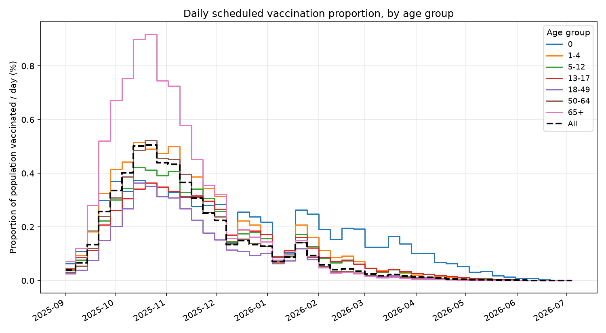

*Daily scheduled vaccination proportion*

## Appendix C — Attack rate by vaccination status (baseline)

Share of each group infected over the season, median [95% interval]. Vaccinated = vaccinated at any point in the season (delivered doses), with their infections after vaccination; unvaccinated = everyone else, seeded infections included. The model never vaccinates someone already infected, so an infection before a person's vaccination date counts as unvaccinated. This timing effect lowers the vaccinated attack rate even where vaccination blocks no infection (65+).

| Age group | Share vaccinated | Vaccinated | Unvaccinated | Total |
|---|---:|---:|---:|---:|
| 0 | 50.0% | 1.8% [1.2–3.0%] | 6.6% [4.6–10.4%] | 4.2% [2.9–6.7%] |
| 1-4 | 47.4% | 2.7% [1.9–4.4%] | 6.8% [4.8–10.9%] | 4.9% [3.4–7.9%] |
| 5-12 | 39.0% | 4.0% [2.8–6.4%] | 9.7% [6.9–15.3%] | 7.5% [5.3–11.9%] |
| 13-17 | 37.1% | 4.0% [2.8–6.6%] | 10.1% [7.2–15.9%] | 7.9% [5.6–12.5%] |
| 18-49 | 27.4% | 4.9% [3.5–8.0%] | 7.9% [5.6–12.6%] | 7.1% [5.0–11.4%] |
| 50-64 | 38.1% | 4.4% [3.1–7.2%] | 7.0% [4.9–11.2%] | 6.0% [4.2–9.7%] |
| 65+ | 61.3% | 3.4% [2.4–5.6%] | 4.4% [3.1–7.0%] | 3.8% [2.7–6.2%] |
| **All** | **38.5%** | **4.1% [2.9–6.7%]** | **7.6% [5.3–12.0%]** | **6.2% [4.4–10.0%]** |
